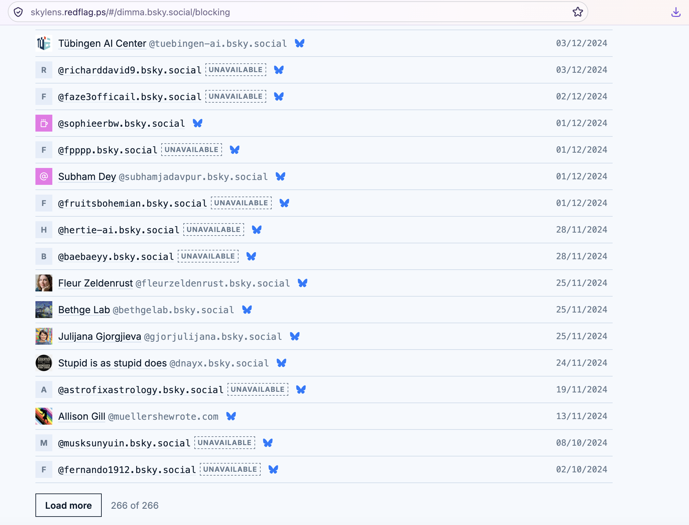
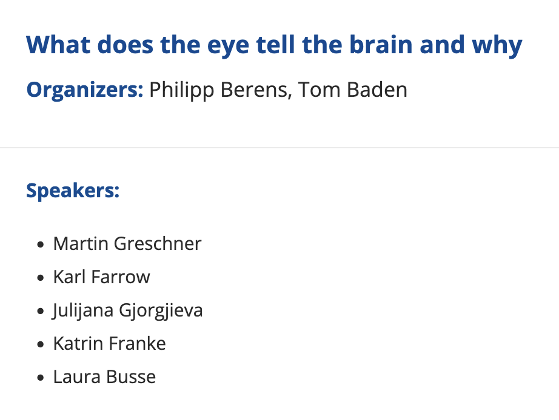

### I believe deeply in collaboration, mutual uplift, and generosity.

### I have  no respect  for those who approach life with a scarcity mindset, who sabotage competition, or worse, abuse positions of power to undermine, exploit, and silence[^1] those they are meant to support.

Unfortunately, over the past years, I’ve learned that integrity isn’t always welcomed, but it’s the only way I know to move forward.

### I am in general VERY resistant to intimidation or any form of dominance display. Anyone who wants to influence my judgement or my perspective should only try to reason. 
----

[^1]: You may get some hint by going here [https://clearsky.app/dimma.bsky.social/blocking](https://clearsky.app/dimma.bsky.social/blocking) and scrolling all the way down. Then try looking at past Bernstein conferences and workshops ~2015.
[Edit on 2026] I just realised that clear sky doesn't properly show blocks anymore, so let's fix this. Here is a screenshot of the bottom of my block list  ( [https://skylens.redflag.ps/#/dimma.bsky.social/blocking](https://skylens.redflag.ps/#/dimma.bsky.social/blocking) ). \
Focus on 25th of November 2024. \
\
And then check who was the PhD advisor of the organiser of this Bernstein 2015 workshop  \
and then ask to find out whether that advisor offered to any one of the speakers a professorship shortly after the workshop, that they might have used to negotiate the PI position they officially got around that time, and then you may get an answer of **who protects the interests of whom and who forwards information to whom**. \
And this might also explain why within the first month after I joined my previous postdoctoral lab, my previous advisor tried to put me in collaboration with people from the university
of the person who tries to control my career and in a project in which he was until recently involved, i.e. trying from the get go to give power over me to the person who is creating problems for me for years and eventually allowing him to decide and influence the output of my postdoc. The project was a continuation of this work and you can reach the acknowledgements about the involvement of the person in question [paper](https://www.biorxiv.org/content/10.1101/2021.02.19.431943.abstract), and after the brief first online meeting where the otherwise lovely PI mentioned that until recently MB was responsible for the data analysis ideas of the project I said I cannot be part of the project. \
Read also this post: [https://dimitra-maoutsa.github.io/M-Dims-Blog/posts/Wayback.html](https://dimitra-maoutsa.github.io/M-Dims-Blog/posts/Wayback.html)

