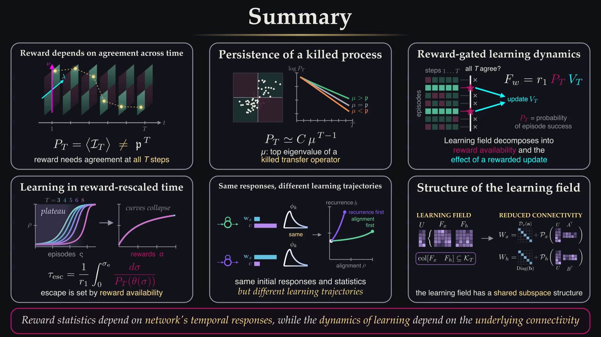

We study learning dynamics with local reward-modulated plasticity rules both in linear and non-linear recurrent neural networks (RNNs).

The first part of this work on linear RNNs has been accepted in NeurIPS 2026 main conference and will appear soon online [see here](https://dimitra-maoutsa.github.io/M-Dims-Blog/posts/Neurips_accepted_paper.html). \
See here the project page (_still under construction but somewhat more informative_) [project page](https://dimitra-maoutsa.github.io/RL-lRNN-learning-dynamics/)

Extensions on this work on more complicated settings and work on theory on reward-modulated learning in nonlinear RNNs will appear here and online as they become ready. Stay tuned!
