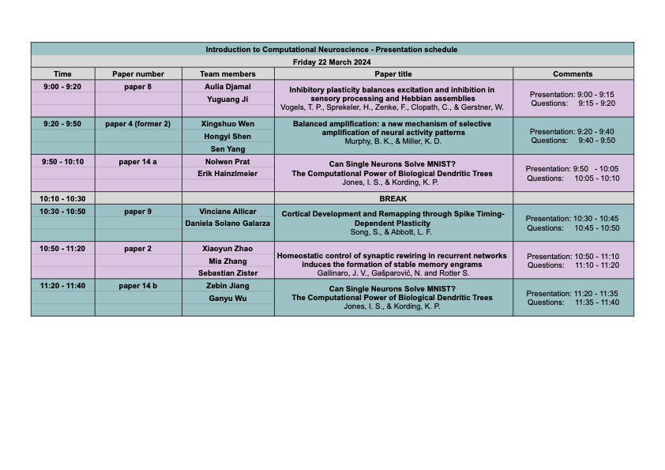
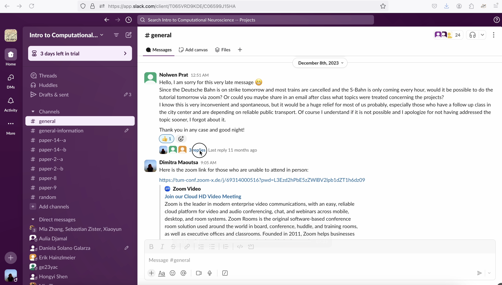
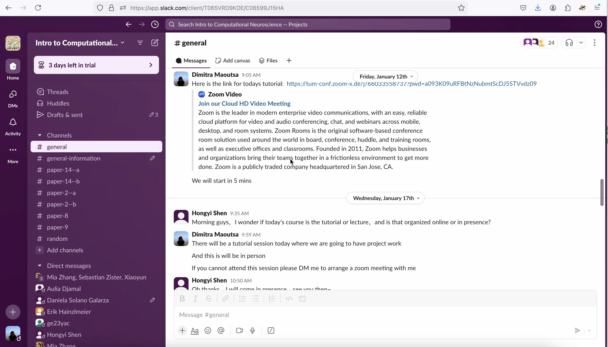
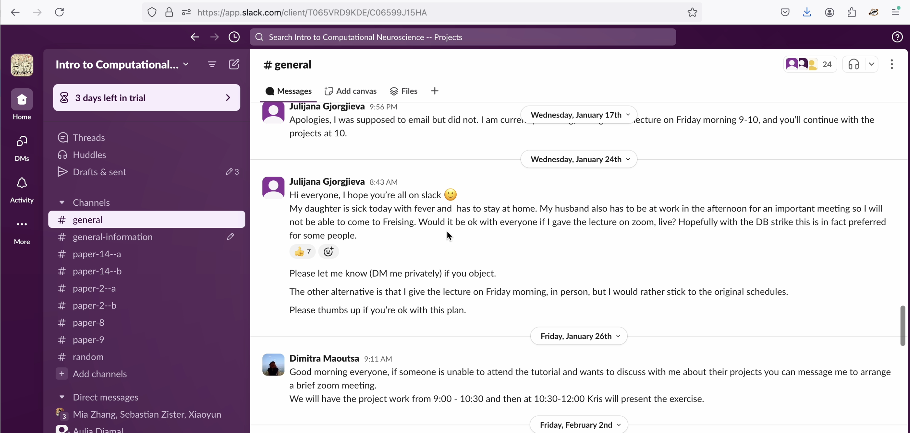
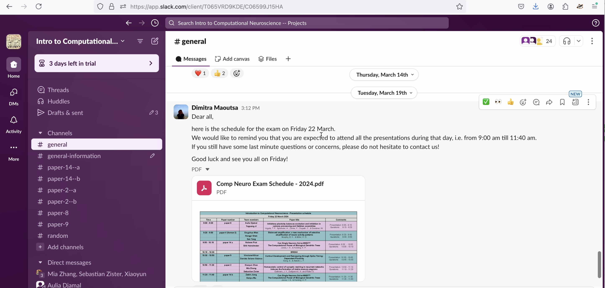
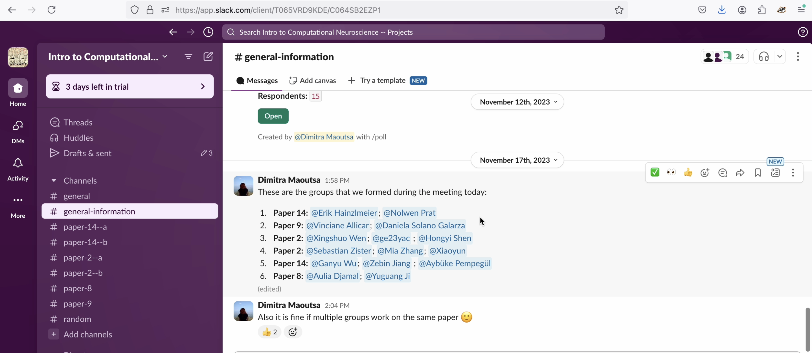
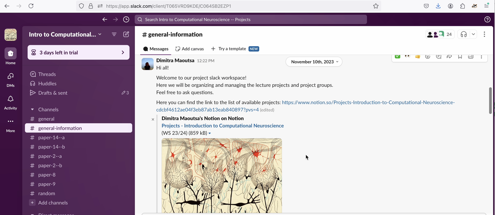

Solely directed and mentored 6 groups (2-3 students each) in executing practical research projects that served as their final evaluation for the lecture **Introduction to Computational Neuroscience**.

Time commitment: >1.5 h/week

 Here is the website with the project descriptions the students had to choose from: [projects website](https://repeated-law-b5a.notion.site/Projects-Introduction-to-Computational-Neuroscience-cdcbf4612ae04f3eb87ab13eab840897) and here is what they did choose: 
  

I wish I wouldn't have to provide this sort of proof but alas

